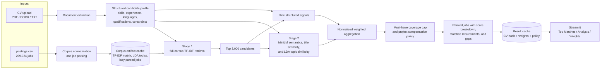

# NLP for Job Recommendation — Data Engineering Case Study

[](https://www.python.org/)
[](https://streamlit.io/)
[](LICENSE.md)

A CV-to-job matching engine for Data Engineering roles. It parses a résumé into structured attributes, scores it against a corpus of ~210,000 job postings using nine weighted signals, and returns a ranked shortlist with an explanation of why each job matched and what is missing.

The design goal is **explainable ranking**. A single cosine similarity gives a number nobody can argue with or act on; this system decomposes the score into named components, and every result carries a "why matched" and a "gaps" list derived from the same components that produced the score.

Status: academic project (text mining), runs locally as a Streamlit app.

## Architecture

The matcher uses a two-stage retrieval design so the expensive semantic models do not run over all 209,924 postings for every CV.



The module-level corpus cache is keyed by row count, columns and source-file modification time. The Streamlit layer caches rankings by the CV content hash, weight vector and project-compensation policy. Changing only the display count reuses the previous ranking.

### Current deployment boundary

This repository is a local analytical prototype. It loads `postings.csv` at process start and retains corpus artifacts in memory; it does not currently provide multi-user isolation, persistent model artifacts, background indexing, authentication, or production monitoring.

## Approach

### 1. CV parsing

`parse_uploaded_file` accepts PDF, DOCX or TXT (via `pdfplumber` / `python-docx`) and extracts structured fields rather than raw text:

- **Skills, tagged by provenance** — each skill is recorded as coming from work experience or from personal projects, which the scorer later treats differently
- **Experience duration** — parsed from date ranges in the document and totalled in months, not just a self-declared "X years"
- **Seniority** — inferred from titles and total duration
- **Languages with CEFR levels** — normalised to A1–C2, with country/language name resolution via `pycountry` rather than a hardcoded list
- **Certifications, education, expected salary, work-mode preference, soft skills**

### 2. Job corpus

209,924 LinkedIn job postings with fields `job_title`, `company`, `job_location`, `job_link`, `first_seen`, `search_city`, `search_country`, `job level`, `job_type`, `job_summary`, `job_skills`.

Each posting is parsed into a canonical `job_text` plus structured requirements: **must-have** versus **nice-to-have** skills, required years, seniority, required languages, salary range and work mode.

### 3. Scoring

Nine signals, each normalised and combined under weights that are renormalised to sum to 1:

| Signal | Default weight | Method |
| --- | --- | --- |
| Skills proficiency | 0.30 | Must-have coverage (80%) + nice-to-have coverage (20%) |
| Semantics | 0.15 | Sentence-transformer embeddings (`all-MiniLM-L6-v2`), cosine |
| Experience | 0.15 | Seniority comparison, scaled down when years fall short |
| Keywords | 0.10 | TF-IDF cosine over the job corpus |
| Topics | 0.10 | LDA topic-distribution similarity (gensim) |
| Qualifications | 0.10 | Education level + certifications relevant to the posting |
| Soft skills | 0.08 | Extracted soft-skill overlap |
| Languages | 0.05 | CEFR gate against required levels |
| Constraints | 0.05 | Salary fit + work-mode preference |

Two mechanisms do the interesting work:

**Must-have gating.** Coverage of required skills caps the total score before weighting — below 25% coverage the score is capped at 0.35, below 50% at 0.55. This prevents a candidate from compensating for missing core requirements with strong scores elsewhere, which is the standard failure mode of purely additive matchers.

**Project compensation.** When a required skill is absent from work history but present in a personal project, it contributes a partial credit (+0.05 each) instead of counting as a hard gap. This is toggleable, because whether side projects should count is a recruiting policy decision rather than a technical one.

### 4. Explanation and evaluation

Every ranked result carries a breakdown of per-signal contributions, matched and missing must-haves, gaps filled by projects, language status and role relevance. The Analysis tab reports **precision@k** for k ∈ {1, 3, 5} against a synthetic ground truth built from skill overlap.

## Installation

```bash
pip install -r requirements.txt
```

The job corpus is not committed. Place a `postings.csv` with the columns listed above in the project root — `matching_system.py` loads it at import time.

## Usage

```bash
streamlit run app.py
```

Upload a CV in the sidebar, then use the three tabs: **Top Matches** for the ranked shortlist, **Analysis** for precision@k and the score-contribution chart, **Weight Settings** to retune the nine weights and toggle project compensation live.

## Repository structure

```
app.py               Streamlit interface: upload, tabs, weight sliders, explanations
matching_system.py   Parsing, corpus artefacts, the nine scoring signals, evaluation
```

`matching_system.py` is importable on its own — `run_comprehensive_matching(cv, jobs_df, weights)` returns the ranked DataFrame without any UI.

## Performance notes

Embedding and TF-IDF artefacts for the full corpus are computed once and held in a module-level cache keyed on a job-corpus signature (row count, columns, file mtime), so re-ranking against new weights does not recompute them. The Streamlit layer adds a second cache keyed on a SHA-256 of the CV text plus the weight vector, so changing only the number of displayed results reuses the stored ranking instead of re-running the pipeline.

## License

This software is available under the [PolyForm Noncommercial License 1.0.0](LICENSE.md). Research, education, personal experimentation, modification and redistribution are permitted for noncommercial purposes under its terms. Commercial use is not licensed; contact the copyright holder to discuss separate commercial permission.

## Technologies

Python · Streamlit · scikit-learn · gensim · sentence-transformers · pandas · NumPy · pdfplumber · python-docx

## Skills demonstrated

- Information extraction from unstructured documents into a typed schema
- Hybrid retrieval combining lexical (TF-IDF), topical (LDA) and dense (transformer embedding) signals
- Explainable scoring: decomposable weights, gating constraints, and per-result justification
- Ranking evaluation with precision@k against a constructed ground truth
- Cache design for interactive use over a large corpus
